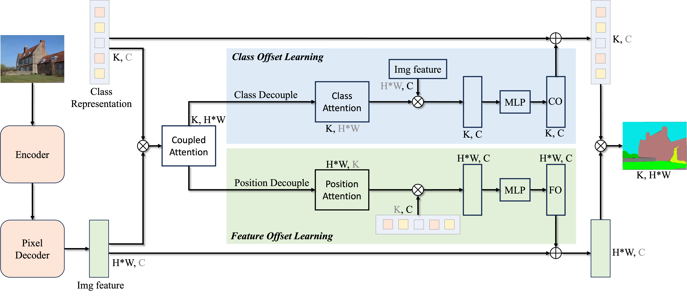

# Revisiting Efficient Semantic Segmentation: Learning Offsets for Better Spatial and Class Feature Alignment (ICCV 2025)

### [Project page](https://github.com/HVision-NKU/OffSeg) | [Paper](https://mftp.mmcheng.net/Papers/25ICCV-OffsetLearning.pdf) | [arXiv](https://arxiv.org/abs/2508.08811) | [中译版](project/offseg/resources/25ICCV-OffsetLearning-cn.pdf) | [Jittor]()

This repository contains the official [Jittor](https://github.com/Jittor/jittor) implementation of [Offset Learning & OffSeg](https://arxiv.org/abs/2508.08811).

### Offset Learning —— An efficient plug-and-play semantic segmentation paradigm that replaces existing per-pixel classification paradigm to boost performance with negligible parameters.


*Overview of the Offset Learning framework for semantic segmentation.*

<details>
<summary>Abstract</summary>
Offset Learning is a new semantic segmentation paradigm that efficiently learns feature offsets and class offsets to dynamically refine both spatial features and class representations, addressing the inherent misalignment problem in per-pixel classification. Based on this paradigm, we design OffSeg, an efficient segmentation network that delivers consistent accuracy improvements on multiple benchmarks. Notably, the Offset Learning paradigm is plug-and-play, allowing it to directly replace other segmentation paradigms in existing models to achieve performance gains with only negligible parameter overhead.
</details>

## Features
* **Offset Learning**: Learns feature offsets and class offsets to dynamically refine spatial features and class representations.
* **Plug-and-play**: Compatible with existing segmentation frameworks like SegFormer, SegNeXt, and Mask2Former.
* **Lightweight & Efficient**: Achieves consistent accuracy gains on multiple benchmarks with negligible parameter overhead.
* **Proven Effectiveness**: Validated across diverse models and datasets, showing strong improvements especially in lightweight settings.

## Get Started

### Installation

```bash
pip install jittor
pip install -r requirements.txt
python setup.py develop
```

### Data Preparation

For data preparation, please refer to the guidelines in [mmsegmentation](https://github.com/open-mmlab/mmsegmentation/blob/main/docs/en/user_guides/2_dataset_prepare.md#prepare-datasets).
It is recommended to symlink the dataset root to `OffSeg/datasets`.

<details>
<summary>For convenience, the recommended folder structure is as follows: </summary>

```
OffSeg
├── data
│   ├── ade
│   │   ├── ADEChallengeData2016
│   │   │   ├── annotations
│   │   │   │   ├── training
│   │   │   │   ├── validation
│   │   │   ├── images
│   │   │   │   ├── training
│   │   │   │   ├── validation
│   ├── cityscapes
│   │   ├── leftImg8bit
│   │   │   ├── train
│   │   │   ├── val
│   │   ├── gtFine
│   │   │   ├── train
│   │   │   ├── val
│   ├── coco_stuff164k
│   │   ├── images
│   │   │   ├── train2017
│   │   │   ├── val2017
│   │   ├── annotations
│   │   │   ├── train2017
│   │   │   ├── val2017
│   ├── VOCdevkit
│   │   ├── VOC2010
│   │   │   ├── JPEGImages
│   │   │   ├── SegmentationClassContext
│   │   │   ├── ImageSets
│   │   │   │   ├── SegmentationContext
│   │   │   │   │   ├── train.txt
│   │   │   │   │   ├── val.txt
│   │   │   ├── trainval_merged.json
```

</details>

## Training

```bash
# Train on ADE20K
python tools/run_net.py --config-file=project/offseg/tiny/offset_learning_tiny_512x512_ade_160k.py --task=train

# Train on Cityscapes
python tools/run_net.py --config-file=project/offseg/tiny/offset_learning_tiny_1024x1024_cityscapes_160k.py --task=train
```

## Evaluation

```bash
# Test on ADE20K
python tools/run_net.py --config-file=project/offseg/tiny/offset_learning_tiny_512x512_ade_160k.py --task=train --resume=path/to/ckp --task=val

# Test on Cityscapes
python tools/run_net.py --config-file=project/offseg/tiny/offset_learning_tiny_1024x1024_cityscapes_160k.py --task=train --resume=path/to/ckp --task=val
```


## Citation

If you find this work useful for your research, please cite our paper:

```bibtex
@article{zhang2025revisiting,
  title={Revisiting Efficient Semantic Segmentation: Learning Offsets for Better Spatial and Class Feature Alignment},
  author={Zhang, Shi-Chen and Li, Yunheng and Wu Yu-Huan and Hou, Qibin and Cheng, Ming-Ming},
  journal={arXiv preprint arXiv:2508.08811},
  year={2025}
}
```

## Acknowledgment

This project is built upon [nk-seg](https://github.com/NK-JittorCV/nk-seg). We thank the team for their open-source contribution.


## License
The code is limited to non-commercial, academic, or research purposes only. For commercial use, please contact the authors for licensing.

## Contact

For questions and issues, please contact:
- Email: [zhangshichen@mail.nankai.edu.cn]
- Issues: [GitHub Issues](https://github.com/HVision-NKU/OffSeg/issues)
